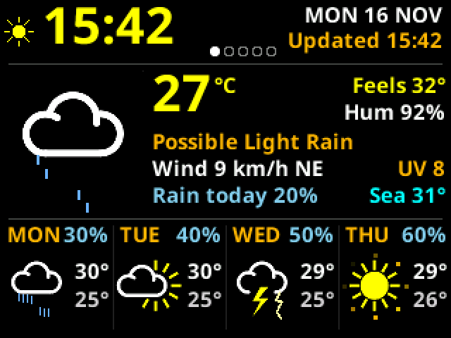
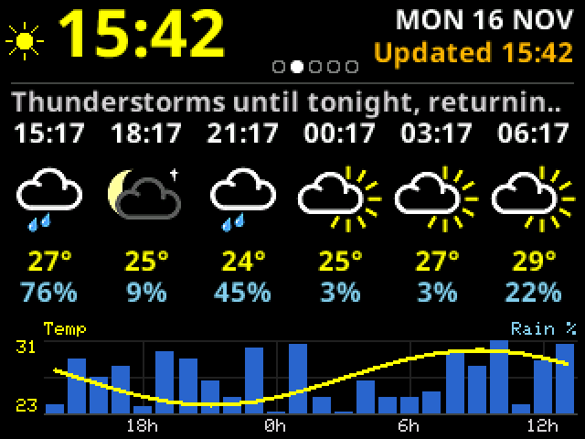
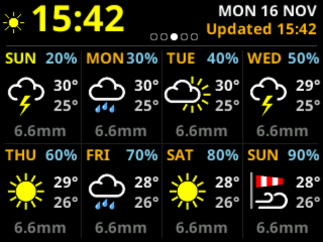
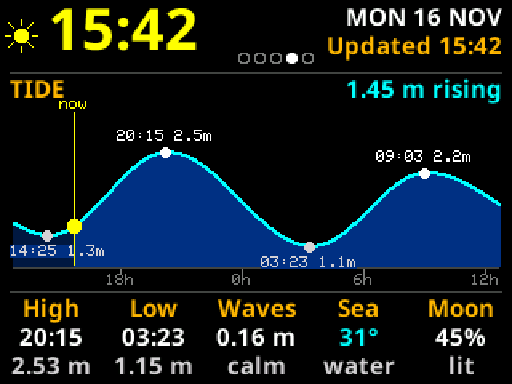
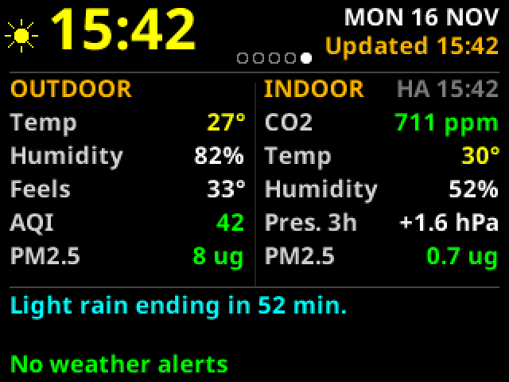
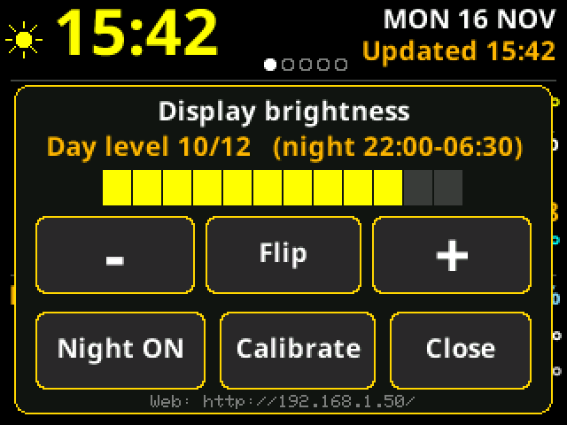

# CYD Weather Station – Landscape / Pirate Weather / Touch edition

An extended version of the CYD weather station in this repository for the 2.8" **ESP32-2432S028R**
"Cheap Yellow Display" (320 x 240). It keeps the look of the original (same icons, fonts and
LittleFS data) and adds landscape layout, touch control, animations and much more weather data.

| Now (animated) | Hourly | 8 days |
|---|---|---|
|  |  |  |

| Tide & sea (Home Assistant) | Air & home (Home Assistant) | Menu |
|---|---|---|
|  |  |  |

*Images are rendered 1:1 from the firmware with a host-side display simulator using the real fonts and icons of this repository.*

## What is new compared to the original sketch

| | Original | This edition |
|---|---|---|
| Orientation | Portrait | **Landscape** 320 x 240, flip 180° on the device |
| Data source | OpenWeatherMap 3-hourly | **Pirate Weather** (ECMWF / GFS / radar nowcast), free API key |
| Forecast | 4 days | Now, **24 h hourly** (tiles + temperature / rain chart), **8 days** |
| Values | temp, wind, pressure, clouds, humidity | + feels like, UV max, rain probability and amount, dew point, gusts |
| Touch | – | XPT2046 bit-bang driver (no extra library), 3-point calibration stored in NVS |
| Animations | – | animated weather icons: rain / drizzle / snow / hail falling, lightning flashes, sun sparkle, twinkling stars, drifting clouds and fog |
| Backlight | fixed | PWM, 12 levels, night dimming window, first touch at night only wakes the display |
| Web interface | – | status page with **live screenshot**, REST API, remote tap, **firmware upload (OTA)** |
| Home Assistant | – | optional: tide curve, waves, sea temperature, outdoor / indoor air (CO2, PM2.5, AQI), pressure trend, lightning, alerts |
| Time | NTP + Timezone library | ESP32 SNTP + POSIX TZ string (no Time / Timezone library) |

## Pages

Tap the right two thirds of the screen for the next page, the left third for the previous one.

1. **Now** – animated icon, temperature, feels like, humidity, summary, wind, UV, rain chance, 4 animated day tiles
2. **Hourly** – summary, 6 tiles (every 3 h), 24 h chart with temperature line and rain-probability bars
3. **8 days** – high / low, rain probability and amount
4. **Tide & sea** *(Home Assistant)* – 24 h tide curve with "now" marker, next high / low, waves, sea temperature, moon
5. **Air & home** *(Home Assistant)* – outdoor and indoor values, nowcast text, alert line (lightning only appears when a strike is reported nearby)

Tap the **clock / header** to open the menu: brightness – / +, Flip (180°), night mode on/off,
touch calibration. **Long press** (1.5 s) anywhere reloads the data. Touching the screen during the
boot splash starts the touch calibration.

## Setup

1. **TFT_eSPI**: use the User_Setup for your board exactly as described in the main README of this repository.
2. **Libraries** (Arduino Library Manager): `TFT_eSPI`, `ArduinoJson` 7.x.
   OpenWeather, JSON_Decoder, Time and Timezone are **not** needed by this sketch.
3. **LittleFS data**: the sketch uses the same icons and fonts as the original. If you already ran
   the original sketch nothing needs to be uploaded. Otherwise copy the `data` folder from
   `Esp32_CYD_TFT_eSPI_OpenWeather_LittleFS_v02` into this sketch folder and upload it with the
   arduino-littlefs-upload plugin (LittleFS partition of at least 1.5 MB, see main README).
4. Edit **`All_Settings.h`**: WiFi, Pirate Weather API key (free at https://pirateweather.net),
   coordinates, units, POSIX time zone, and change `WEB_PASS`.
5. Compile and upload. On first boot tap the three red crosses for the touch calibration.
   The boot screen shows the IP address of the web interface.

Tested with Arduino IDE 2.3, arduino-esp32 core 3.x (core 2.x compiles as well), TFT_eSPI 2.5.43, ArduinoJson 7.4.

## Web interface and REST API

Open `http://<ip>/` (the IP is shown on the boot screen and at the bottom of the brightness menu).

| Endpoint | Function |
|---|---|
| `/` | status page with live screenshot (click into the screenshot = tap on the display), log, buttons |
| `/api/status` | JSON: weather values, Home Assistant values, HTTP diagnostics of the last fetches, heap, UI state |
| `/api/log` | last 40 log lines |
| `/api/screenshot.bmp` | current display content as BMP |
| `/api/tap?x=&y=` | simulate a touch |
| `/api/page?n=next\|prev\|0..4` | switch page |
| `/api/refresh` | reload weather (+ Home Assistant) now |
| `/api/brightness?d=±1` or `?day=0..11&night=0..11` | brightness |
| `/update` | firmware upload (basic auth `WEB_USER` / `WEB_PASS`). Arduino IDE: *Sketch → Export Compiled Binary*, upload the `.ino.bin` file |

The web server is meant for your local network only – do not expose it to the internet.

## Home Assistant (optional)

Set `HA_ENABLED true`, `HA_URL` and a long-lived access token in `All_Settings.h`.
The display sends **one** `POST /api/template` request every 2 minutes; the Jinja template in
`HA_Template.h` renders all values as compact JSON. Replace the example entity IDs with your own –
missing sensors are shown as `--`, so you can use only the parts you need.
Test the template in Home Assistant under *Developer tools → Template* before flashing.

The tide page expects a sensor with an attribute `predictions` holding a list of extremes:
`[{"time": "2026-11-16T14:03:31+07:00", "height": 2.34, "type": "high"}, ...]`
(for example a template / REST sensor built on any tide API). The display interpolates the curve
between the extremes (cosine) and draws the next 24 hours.

## Pirate Weather quota

With `UPDATE_INTERVAL_MIN 10` the station needs about 4,400 calls per month, well inside the free
tier. The API response is streamed and filtered with ArduinoJson, so only the needed fields are kept in RAM.

## Credits

Based on the weather station by Daniel Eichhorn (https://blog.squix.ch), adapted by Bodmer
(https://github.com/Bodmer/OpenWeather) and AndroidCrypto (this repository). MIT License.
Weather data: Pirate Weather (https://pirateweather.net).
